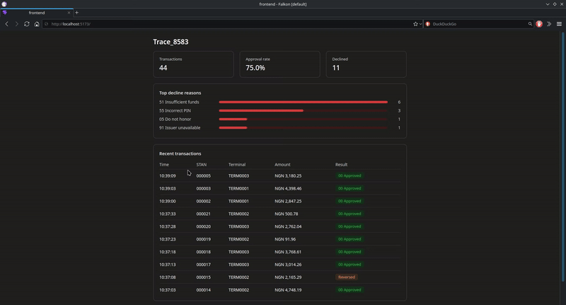

# Trace_8583

An ISO 8583 transaction ledger and monitoring dashboard: it parses card-network messages, stores them with correct request/response and reversal pairing, and shows approval rate, decline reasons, and recent transactions live.

Built on top of [iso_8583](https://github.com/LOVE-CRAFTT/iso_8583_parser), an ISO 8583 parser I wrote earlier.

## What it does

A generator produces linked test traffic (purchase, response, occasional reversal) as hex messages. The parser decodes them, the backend stores them in Postgres with every response linked to its request and every reversal to the transaction it undoes, and a React dashboard polls the API every few seconds.

**Stack:** Python 3.14, FastAPI, SQLModel, PostgreSQL, React, TypeScript, Vite.

## Run it

Needs Python 3.14+ with [uv](https://docs.astral.sh/uv/), Node.js, and PostgreSQL.

1. Create a database and role (`CREATE DATABASE trace_8583;` in `psql`).
2. Copy `backend/.env.example` to `backend/.env` and `frontend/.env.example` to `frontend/.env`, then fill in the credentials.
3. Backend: `cd backend && uv run fastapi dev` (creates the tables and view on startup).
4. Frontend: `cd frontend && npm install && npm run dev`, then open the address Vite prints.

## Design notes

- **No card data stored.** The PAN is masked (first 6, last 4) before it reaches a model, and the PAN, expiry, and track 2 data are removed from the stored raw JSON. A test scans every table for a full card number.
- **Matching.** A response echoes its request's STAN, terminal, and local date. A reversal gets its own STAN and carries the original's identity in field 90, which is how it finds the transaction it undoes.
- **Status is derived.** Approved, declined, reversed, and pending are computed by a database view, so there is no stored copy to drift out of sync.
- **Wire format is not the storage model.** ISO 8583 fields are fixed-width text with no year in any timestamp, so they are kept as text and the dashboard orders by the database's own `created_at`.

## Scope

Supports purchase and reversal messages (0200 / 0210 / 0400 / 0410) from the 1987 version, ASCII-encoded with a binary bitmap. Authorizations, advices, network management, settlement, and packed BCD are not supported. There is no authentication, and it is not containerized yet.

## How AI was used

Built with AI assistance (Claude) as a collaborator: it generated parts of the test-message generator and hex packer, the status view SQL, the model definitions, and the dashboard component, and reviewed my code. I wrote the underlying parser, the field mapping, the insert and dispatch logic, and the tests, and made the design decisions in discussion with it.
